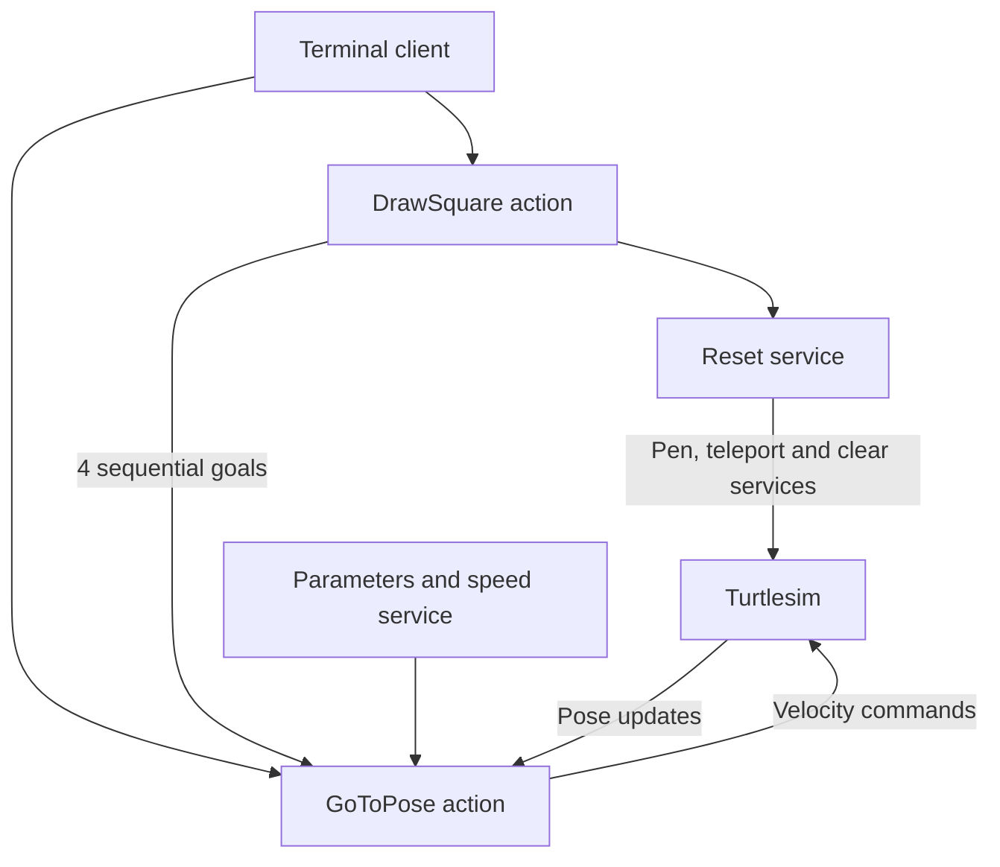

<div align="center">

# ROS 2 Turtlesim Control

**MEC356 · Design of Mechatronic Systems · Lab 1**

Pose control, live speed limits, and square drawing with ROS 2 actions and services.


[Quick start](#quick-start) · [Usage](#usage) · [Architecture](#architecture) · [Verification](#verification)

</div>

---

## At a glance

| Capability | Implementation |
| :--- | :--- |
| **Move to a pose** | Reach a target position and final heading with action feedback |
| **Draw a square** | Reset, then execute exactly four sequential pose goals |
| **Reset the scene** | Disable the pen, teleport to the centre, clear and restore the pen |
| **Tune while moving** | Update linear and angular speed limits through parameters or a service |
| **Launch together** | Start turtlesim and all servers with one launch command |


## Team

| Team member | Student ID |
| :--- | :---: |
| Osama Medhat | 2304156 |
| Ziad Mohamed | 2304154 |
| Anas Mohamed | 2304149 |

## Packages

| Package | Responsibility |
| :--- | :--- |
| [`lab1_interfaces`](lab1_interfaces) | Custom target message, pose and square actions, speed-limit service |
| [`lab1_control`](lab1_control) | Controller, action servers, reset and speed services, launch and configuration |

Targets use turtlesim coordinates and radians. `/go_to_pose` implements the assignment's goToPose action; `/draw_square` draws counterclockwise from the centre. The node `/lab1_server` contains both action servers and both services. The square resets first, then sends exactly four sequential pose goals. No extra repositioning goal is used. Final corner headings prepare each following side.

## Quick start

### 1. Install dependencies and clone

Requires Ubuntu 24.04 with ROS 2 Jazzy Desktop installed. On Windows with WSL, open the Ubuntu terminal first. Build in the Ubuntu filesystem.

```bash
source /opt/ros/jazzy/setup.bash
sudo apt update
sudo apt install git ros-jazzy-turtlesim python3-colcon-common-extensions
mkdir -p ~/mec356_lab1_ws/src
git clone https://github.com/Oselazab/Lab1_ROS2_Assignment-2-.git ~/mec356_lab1_ws/src/lab1
```

### 2. Build and launch

```bash
cd ~/mec356_lab1_ws
colcon build --symlink-install
source install/setup.bash
ros2 launch lab1_control lab1.launch.py
```

The launch starts `/turtlesim` and `/lab1_server`, including both actions and both services. Speed defaults are loaded from `lab1_control/config/limits.yaml`. After editing this file, rebuild and relaunch to apply its startup values.

### 3. Prepare another terminal

Keep the launch terminal running. In **each new Ubuntu terminal**:

```bash
source /opt/ros/jazzy/setup.bash
source ~/mec356_lab1_ws/install/setup.bash
```

## Usage

> [!IMPORTANT]
> Run the following commands in a sourced terminal while the launch is running. Use one motion client at a time.

### Move to a pose

```bash
ros2 action send_goal /go_to_pose lab1_interfaces/action/GoToPose \
  "{target: {x: 8.0, y: 7.0, yaw: 1.5708}}" --feedback
```

Try left/down/behind targets and different final headings. Position tolerance is 0.04 units; yaw tolerance is 0.03 rad. Targets must be finite, with x and y in [0.2, 10.8]. Yaw is wrapped when calculating errors. A goal aborts after 180 seconds or if pose updates stop for two seconds. Very low valid speed limits may therefore cause a timeout. Concurrent motion goals are rejected. Do not drive with teleop while an action is running.

### Reset the scene

```bash
ros2 service call /reset_turtle std_srvs/srv/Trigger '{}'
```

The reset disables the pen, teleports to (5.544445, 5.544445, 0), clears the screen and restores the white pen. It returns a success/message response and rejects a reset during motion. Call it twice to verify repeatability.

### Adjust speed limits

```bash
ros2 param list /lab1_server
ros2 param get /lab1_server max_linear_speed
ros2 param get /lab1_server max_angular_speed
ros2 param set /lab1_server max_linear_speed 1.0
ros2 param set /lab1_server max_angular_speed 1.5
ros2 service call /set_speed_limits lab1_interfaces/srv/SetSpeedLimits "{max_linear_speed: 0.8, max_angular_speed: 1.2}"
ros2 param get /lab1_server max_linear_speed
ros2 param get /lab1_server max_angular_speed
ros2 service call /set_speed_limits lab1_interfaces/srv/SetSpeedLimits "{max_linear_speed: -1.0, max_angular_speed: 1.0}"
```

The final command is an **invalid-input check**. It should return `success: false`; neither speed limit should change. Both limits must be positive finite doubles. The service updates both atomically, so an invalid request changes neither. Speeds are read every control cycle (50 Hz), including changes made while moving. Use decimal values in parameter commands.

| Parameter | Default | Unit |
| :--- | ---: | :--- |
| `max_linear_speed` | 2.0 | turtlesim units/s |
| `max_angular_speed` | 2.0 | rad/s |

### Draw a square

```bash
ros2 action send_goal /draw_square lab1_interfaces/action/DrawSquare \
  '{side_length: 2.0}' --feedback
```

Repeat the command to verify a clean reset on the second run. Feedback reports the current side and completed sides. Side lengths must be finite and between 0.2 and approximately 5.2555 so the square stays inside the window. Each successful square logs exactly four accepted goToPose goals. An active square rejects other square requests and unrelated pose requests. Cancellation propagates to the current pose action and stops the turtle.

## Architecture




`controller.py` contains the pure steering function, while `server.py` handles ROS actions, services and parameters. This separates control calculations from ROS communication. The controller first turns toward the target and translates, then aligns the final yaw. The square action reuses the reset service and pose action rather than duplicating the steering logic.

A reentrant callback group with an eight-thread executor allows subscriptions, service replies and action results to progress while orchestration waits. Locks guard action admission and reset ownership. The pose action publishes zero velocity when it ends; square cancellation forwards cancellation to the active pose goal.

## Verification

With the launch running and no other client controlling the turtle, execute the integration checks in a sourced Ubuntu terminal:

```bash
python3 ~/mec356_lab1_ws/src/lab1/tests/verify_lab.py
```

| Check group | Recorded result |
| :--- | :---: |
| Repeated reset and parameter validation | Passed |
| Four motion directions and final heading | Passed |
| Live speed caps, overlapping goals and motion cancellation | Passed |
| Two consecutive square runs | Passed |
| Square bounds, cancellation and reset recovery | Passed |

The test moves the turtle and changes speed parameters. The recorded run used the real turtlesim node with Qt offscreen; visible GUI review and rosbag replay are outside that test run. Full details: [test results](TEST_RESULTS.md).

## Interface reference

<details>
<summary><strong>Inspect nodes, topics, services and custom interfaces</strong></summary>

```bash
ros2 node list
ros2 topic list
ros2 service list
ros2 action list -t
ros2 interface show lab1_interfaces/msg/TargetPose
ros2 interface show lab1_interfaces/action/GoToPose
ros2 interface show lab1_interfaces/action/DrawSquare
ros2 interface show lab1_interfaces/srv/SetSpeedLimits
ros2 topic echo /turtle1/pose --once
```

</details>

The controller subscribes to `/turtle1/pose` (`turtlesim/msg/Pose`) and publishes `/turtle1/cmd_vel` (`geometry_msgs/msg/Twist`). Reset uses `/clear` (`std_srvs/srv/Empty`), `/turtle1/teleport_absolute` (`turtlesim/srv/TeleportAbsolute`) and `/turtle1/set_pen` (`turtlesim/srv/SetPen`).

For a manual teleop check, with no action running:

```bash
ros2 run turtlesim turtle_teleop_key
```

## Optional rosbag workflow

<details>
<summary><strong>Expand recording and replay instructions</strong></summary>


No rosbag is included in this repository. The following commands describe an optional recording and replay workflow; this workflow has not been verified in the recorded test run.

In a sourced terminal, reset first and start recording:

```bash
ros2 service call /reset_turtle std_srvs/srv/Trigger '{}'
ros2 bag record -o lab1_square /turtle1/cmd_vel /turtle1/pose
```

In another terminal, run the square action. After it succeeds, stop recording with Ctrl+C and inspect:

```bash
ros2 bag info lab1_square
```

Confirm both topics have nonzero message counts. For replay, stop the full lab launch and run **only turtlesim** in one terminal:

```bash
ros2 run turtlesim turtlesim_node
```

In another sourced terminal, restore the start pose and clear, then replay only velocity commands. Publishing recorded poses would interfere with pose observations.

```bash
ros2 service call /turtle1/set_pen turtlesim/srv/SetPen '{off: 1}'
ros2 service call /turtle1/teleport_absolute turtlesim/srv/TeleportAbsolute '{x: 5.544445, y: 5.544445, theta: 0.0}'
ros2 service call /clear std_srvs/srv/Empty '{}'
ros2 service call /turtle1/set_pen turtlesim/srv/SetPen '{r: 255, g: 255, b: 255, width: 3, off: 0}'
ros2 bag play lab1_square --topics /turtle1/cmd_vel
```

Velocity replay is open loop: the turtle must start at the same pose, and playback timing can cause small path differences. Compare the replay visually with the original run.

</details>
